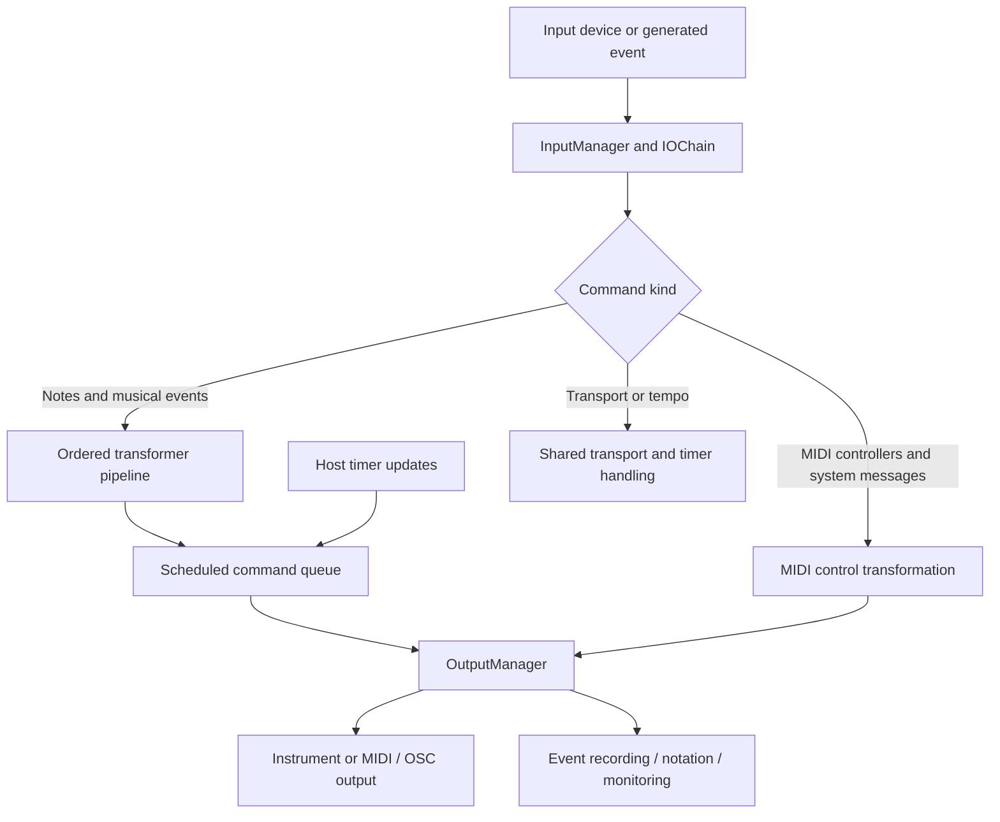
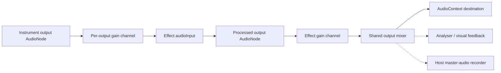
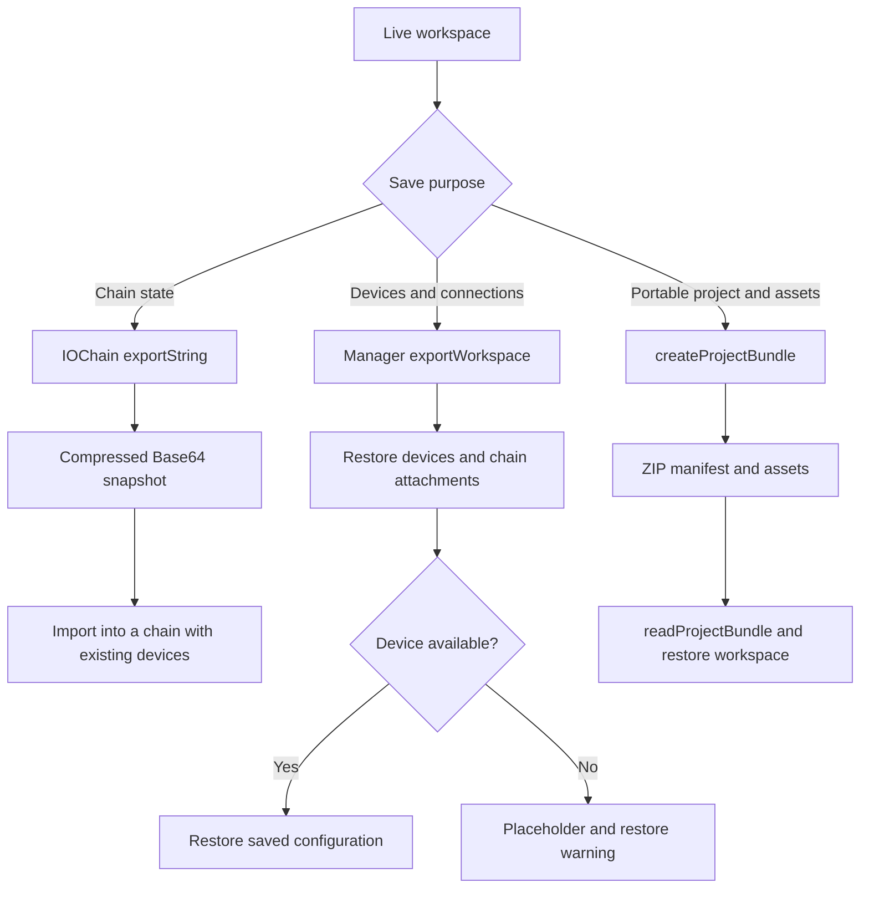

# audiobus

AudioBus is the browser audio and musical-event toolkit behind HarmonEasy. It connects accessible controllers, MIDI devices, sequencers and generated music to ordered transformations, instruments, effects, recording and visual feedback.

The [package manifest](package.json) names the package **`audiobus`** and declares its current version, dependencies and exports. Its entry points are TypeScript source. Use it through the HarmonEasy pnpm workspace and a browser bundler that handles TypeScript, workers, worklets and asset URLs.

## Contents

- [Getting started](#getting-started)
- [How events and audio move](#how-events-and-audio-move)
- [Inputs](#inputs)
- [MIDI hardware profiles and catalog](#midi-hardware-profiles-and-catalog)
- [Transformers](#transformers)
- [Outputs and instruments](#outputs-and-instruments)
- [Audio effects and mixing](#audio-effects-and-mixing)
- [Timing, harmony and ensemble performance](#timing-harmony-and-ensemble-performance)
- [Recording, import, export and persistence](#recording-import-export-and-persistence)
- [Controls, notation and visualisation](#controls-notation-and-visualisation)
- [Integration and extension](#integration-and-extension)
- [Runtime requirements and current limitations](#runtime-requirements-and-current-limitations)
- [Project history](#project-history)
- [Source map and development](#source-map-and-development)

## Getting started

Use Git and the pnpm version declared in the HarmonEasy root `package.json` (currently pnpm 12). Clone the repository with its submodules so workspace dependencies exist before pnpm resolves them:

```sh
git clone --recurse-submodules https://github.com/designerzen/harmoneasy.git
cd harmoneasy
pnpm --filter audiobus... install --frozen-lockfile --ignore-scripts
pnpm --filter audiobus test --run
pnpm --filter audiobus lint
```

The filtered install includes AudioBus and its workspace dependencies and skips lifecycle scripts. Submodules are already initialised by the clone command. For the complete HarmonEasy application, use `pnpm install --frozen-lockfile` and follow the host application's native/Electron setup separately.

For an existing checkout, initialise missing submodules with `git submodule update --init --recursive` before installing. The parent repository's current `postinstall` runs `git submodule update --init --remote --recursive` and targeted dependency updates: an ordinary install can advance submodules to remote branch tips. To keep recorded revisions during an audit or reproducible install, initialise them explicitly and use `pnpm install --frozen-lockfile --ignore-scripts`. `pnpm run upgrade:git` is another explicit upstream-update path. Review dependency commits and the lockfile together; consult the parent manifest for the current lifecycle commands.

The [workspace configuration](../../pnpm-workspace.yaml) links AudioBus dependencies to these Git repository checkouts:

| Dependency | Repository | Workspace checkout |
| --- | --- | --- |
| `control-surface` | [audiobus-control-surface](https://github.com/designerzen/audiobus-control-surface) | `packages/control-surface` |
| `netronome` | [netronome](https://github.com/designerzen/netronome) | `packages/netronome` |
| `pitfalls` | [pitfalls](https://github.com/designerzen/pitfalls) | `packages/pitfalls` |
| `sion` | [SiON](https://github.com/designerzen/SiON) | `packages/sion` |
| `midi-devices` | [midi-devices](https://github.com/designerzen/midi-devices) | `packages/midi-devices` |

The AudioBus manifest also names these dependencies using full `git+https` repository URLs pinned to commit IDs for consumers outside this workspace. The workspace overrides use local submodules instead. Other third-party packages remain package-registry dependencies resolved by the committed lockfile. GitHub file-view (`/blob/`) links, raw source files and copied browser Blob URLs are not installation sources. Browser-generated Blob URLs used internally for workers or recordings are runtime objects, not package dependencies.

The current manifest does not define a standalone build or demo script. Use the HarmonEasy workspace and a bundler for TypeScript, workers, worklets and assets. Changes present only in a local working tree are not available from a fresh clone until committed and published to the relevant repositories.

### Discover and create devices

Use focused source subpaths. Some aggregate entry points currently reference missing modules or exports; see [current limitations](#runtime-requirements-and-current-limitations).

```typescript
import { createInputById, getAvailableInputFactories } from 'audiobus/io/input-factory.ts'
import { createOutputById, getAvailableOutputFactories } from 'audiobus/io/output-factory.ts'
import { KEYBOARD } from 'audiobus/io/inputs/input-types.ts'
import { SYNTH_303 } from 'audiobus/io/outputs/output-types.ts'

// Call from a browser click/tap handler so audio can resume.
async function createKeyboardAndBass() {
  const audioContext = new AudioContext()
  await audioContext.resume()
  const mixer = audioContext.createGain()
  mixer.gain.value = 0.2
  mixer.connect(audioContext.destination)

  console.table(getAvailableInputFactories().map(({ id, name }) => ({ id, name })))
  console.table(getAvailableOutputFactories().map(({ id, name }) => ({ id, name })))

  const input = await createInputById(KEYBOARD, {
    now: () => audioContext.currentTime,
    audioContext
  })
  const output = await createOutputById(SYNTH_303, { audioContext, mixer })
  await output.connect?.()
  return { audioContext, mixer, input, output }
}
```

Creation alone does not route the keyboard to the bass. Attach both devices to an `IOChain`, as below. Availability filters check platform capabilities; creation or connection can still fail because of permissions, missing assets or unavailable hardware.

### Wire a chain to the host clock

The host owns the `netronome` timer and must deliver its time updates. This integration function accepts an existing timer and devices from the previous example:

```typescript
import type { Timer } from 'netronome'
import IOChain from 'audiobus/io/IO-chain.ts'
import type { IAudioInput } from 'audiobus/io/inputs/input-interface.ts'
import type { IAudioOutput } from 'audiobus/io/outputs/output-interface.ts'
import { TransformerTransposer } from 'audiobus/io/transformers/transformer-transposer.ts'

function wireChain(timer: Timer, input: IAudioInput, output: IAudioOutput) {
  const chain = new IOChain(timer)
  // Replace the default Harmoniser with an explicit octave transposition.
  chain.setTransformers([new TransformerTransposer({ enabled: true, distance: 12 })])
  chain.addInput(input)
  chain.addOutput(output)

  return {
    chain,
    // Invoke on each host timer update, using that timer's time domain.
    async update(now: number, divisionsElapsed: number) {
      const due = chain.updateTimeForCommandQueue(now, divisionsElapsed, {})
      await chain.triggerAudioCommandsOnDevice(due)
    },
    destroy() {
      chain.allNotesOff()
      chain.destroy()
    }
  }
}
```

Pass `now: () => timer.now` when creating inputs for this chain. Keep command timestamps and host clock updates in the same time domain; `audioTime` specifically carries AudioContext seconds. For several chains, use [IOChainManager](io/IO-chain-manager.ts), whose `updateTime()` coordinates queue delivery and whose `updateClock()` forwards audio-clock ticks to outputs. The application is responsible for timer subscriptions, transport and final AudioContext/mixer cleanup.

## How events and audio move

An **audio command** describes a note, controller message or transport action; it is not a stream of audio samples. [`IAudioCommand`](commands/audio-command-interface.ts) includes pitch/number, velocity, channel, source, scheduling fields, optional recording provenance, raw MIDI bytes and optional MIDI 2.0 UMP data. Reuse command constants from [commands.ts](commands/commands.ts) and event constants from [event-constants.ts](events/event-constants.ts).



Transformers can expand, change, delay or suppress commands and generate more commands as time advances. The live pipeline runs in order; costly AI processors manage their own workers. Despite its name, `TransformerManagerWorker` does not move every live note transformation to a worker. MIDI controllers and system messages take a separate path so pitch processing and quantisation do not reinterpret them as notes; transport handling also coordinates the shared timer.

The audio path begins inside a sound-producing output and is managed separately from command delivery:



This illustrates one instrument followed by one effect; effects can be chained. MIDI/OSC outputs do not produce an AudioNode. Reordering command transformers is different from routing audio through processors.

## Inputs

[Input factories](io/input-factory.ts), [IDs](io/inputs/input-types.ts) and [definitions](io/input-definitions.ts) describe the available controllers. Devices can expose connection controls, a GUI, time updates and capability flags through [`IAudioInput`](io/inputs/input-interface.ts).

| Family | Functionality and factory IDs |
| --- | --- |
| Keyboard and touch | QWERTY `keyboard`, `onscreen-keyboard`, `pads`, `scale-explorer`, and `music-mouse` for playable note surfaces. |
| Web components | `svg-keyboard`, `circular-controller`, `star-controller`, `sound-wheel`, `relative-touch-controller`, `xy-pitch-controller`, `pitch-bend-grid`, `note-slider`, `note-dial`, `audio-switch`, and `piano-roll` adapt reusable UI components into inputs. |
| Gamepads and switches | `gamepad`, `gamepad-music`, `channel-trigger` and `cosmo-dots` provide controller and trigger-based performance. |
| MIDI hardware | `webmidi`, `ble-midi`, `native-midi` and `midi2-native`; profiled MIDI devices add named controls and device-specific surfaces. |
| Microphone | `microphone-trigger` detects attacks, `microphone-pitch` estimates notes, and `microphone-formant` maps voice characteristics to musical control. |
| Motion and camera | `camera-gestures` uses camera hand tracking; `leap-motion` supports a Leap Motion controller integration. |
| Sequencing and playback | `step-sequencer`, `midi-file` and `event-loop` create or replay event streams. |
| External timing | `midi-transport-clock` receives MIDI transport/clock; `dvs-control-vinyl` derives tempo information from a control-vinyl pilot signal captured through audio input. |
| Network messages | `osc` receives OSC through the configured connection. |
| Generated music | `ai-improv`, `ai-melody`, `ai-drums`, `ai-music-vae` and `ai-trio` select Magenta model modes. `prompt-ai` and `prompt-ai-speech` use browser AI for musical prompts or speech-driven generation. |

The [AI model catalogue](io/inputs/ai-model-catalogue.ts), [speech input guide](io/inputs/INPUT_PROMPT_AI_SPEECH_README.md), [device profiles](hardware/midi-devices/device-profiles.ts) and [component registry](ui/input-components.ts) contain the detailed options. AI models, camera tracking and speech can require downloads or browser-specific APIs.

## MIDI hardware profiles and catalog

Hardware profiles, manufacturer metadata, MIDI mappings, panel diagrams and icons are maintained in the separate [midi-devices repository](https://github.com/designerzen/midi-devices). See its [README](https://github.com/designerzen/midi-devices#readme) for the catalogue, supported hardware, API, asset hosting and contribution instructions.

AudioBus keeps its profile loading, matching and live-control integration in [`hardware/midi-devices/`](hardware/midi-devices/). MIDI protocol, BLE and UMP utilities remain in `midi/`; computer-keyboard and gamepad support remain in their own `hardware/` directories.

A Vite host serves the registry using the dependency's asset plugin:

```typescript
import { midiDeviceFilesPlugin } from 'midi-devices'

export default {
  plugins: [midiDeviceFilesPlugin()]
}
```

Browser integrations refresh the registry and load the matched profile before using it:

```typescript
import {
  refreshMidiDeviceProfiles,
  matchMidiDeviceProfile,
  ensureMidiDeviceProfile
} from 'audiobus/hardware/midi-devices/device-profiles'

await refreshMidiDeviceProfiles()
const id = matchMidiDeviceProfile({ name: 'JU-06' })
const profile = id ? await ensureMidiDeviceProfile(id) : undefined
```

The shared Web MIDI connection flow handles arrival, removal and reconnection, with port claims preventing duplicate profile ownership. Electron loads profiles through `midi-device://registry/`, with user-provided profiles taking precedence over bundled profiles.

[`midi-device-surface.ts`](hardware/midi-devices/midi-device-surface.ts) and [`profiled-midi-gui.ts`](hardware/midi-devices/profiled-midi-gui.ts) provide live controls, MIDI learning and note/CC/message bindings. Profile GUI controls generate commands into an IOChain; route that chain to a MIDI output to control external hardware. For profile fields, schematic conventions and mapping limits, see the [midi-devices README](https://github.com/designerzen/midi-devices#readme).

## Transformers

Transformers operate on musical commands before output delivery. Configure their exposed fields, enable/bypass them and change their order; order affects the result. The [factory](io/transformer-factory.ts) provides `tranformerFactory(type, config)` (the spelling is part of the implementation) and the `TRANSFORMER_TYPE` constants. [Definitions](io/transformer-definitions.ts) provide names, descriptions and categories; [presets](io/transformer-presets.json) provide combinations.

| Area | Processors and behaviour |
| --- | --- |
| Pitch and tuning | **Transposer** shifts semitones; **Constrictor** constrains pitch; **Microtonality** subdivides intervals; **Pitch Mirror** inverts around a centre; **Register Orbit** moves through registers; **Scale Explorer** explores scale material. |
| Chords and voices | **Harmoniser** maps notes to a selected key/scale; **Chordifier** expands notes into chords; **Interval Stack** adds custom offsets; **Voice Leader** minimises movement; **Chord Bloom** gradually grows held harmony. |
| Harmonic development | **Progression Stepper** advances chord sequences; **Harmonic Bridge** connects destinations; **Cadence Weaver** prepares cadences; **Key Traveller** connects tonal centres; **Tension Arc** shapes harmonic preparation; **Melodic Mediator** connects notes with passing and ornamental material. |
| Shared musical context | **Shared Chord Track** follows workspace harmony as melody, bass or chords; **Ensemble** coordinates players and song material; **Improvisation Partner** answers remembered motifs in gaps. |
| Played patterns | **Arpeggiator** plays chord tones once or repeatedly; **Strummer** spreads chord attacks; **Harp** sweeps chords across octaves; **Chord Pattern** replays held chords in fixed rhythms. |
| Timing and feel | **Quantise** aligns a grid; **Groove** reshapes swing/shuffle timing; **Slop** delays each press independently; **Legato** changes overlap and note connections. **Timing Humaniser** currently offsets `command.number` by `config.distance` and has no timing-jitter controls; its display name does not establish implemented humanisation. |
| Echoes and durations | **Note Delay**, **Note Repeater**, **Note Reverb**, **Note Bouncer**, **Note Shortener** and **Release Trigger** delay, repeat, decay, shorten or retrigger notes. These produce musical events rather than audio delay/reverb. |
| Gates and held notes | **Filter** selects commands; **Probability Gate** thins notes; **Euclidean Gate** pulses held notes; **Latch / Hold** sustains them; **Polyphony Limiter** limits voices. |
| Phrase and expression | **Randomiser**, **Velocity Shaper**, **Contour Dynamics**, **Melody Shadow**, **Rhythm Weave**, **Ornamenter**, **Phrase Recombiner**, **Emoji** and **Vibrato** reshape pitch, dynamics, rhythm, remembered material or expressive motion. |
| MIDI routing | **Channeler** selects a channel; **Note Router** splits by pitch/velocity; **Channel Allocator** distributes voices; **Note Mapper** remaps pitches or controllers; **CC Mapper**, **CC Animator** and **CC Stepper** remap or generate controller values. |
| Playback and AI | **MIDI File Player** plays loaded MIDI; **Magenta Melody** and model-specific continuation/variation processors generate musical material; **Browser AI Harmony** uses browser AI. **Identity** passes commands through. |

**Swinger** and **Kill Old Transformer** also have source files and definition entries, but are not explicit cases in the current factory switch. An unknown factory type falls back to Identity; a definition entry alone does not prove that a processor can be instantiated by ID. Inspect the switch before adding saved configurations for these entries.

## Outputs and instruments

[Output factories](io/output-factory.ts) load implementations lazily. Use [output IDs](io/outputs/output-types.ts) rather than guessing strings. [`IAudioOutput`](io/outputs/output-interface.ts) supports basic note methods and optional full-command delivery, clock ticks, harmony updates, GUI creation and audio routing ports.

| Family | Functionality and factory IDs |
| --- | --- |
| Synthesis | `303` is the original AudioBus wavetable bass with distortion and delay; `tb303` and `moog` are WAM-based synths. `fm`, `monotron`, `waveguide` and `multi-oscillator` provide additional synth engines. |
| Larger engines | `yoshimi`, `supersonic` (SuperCollider/scsynth) and `sion` provide alternative synthesis/playback backends. |
| Samples | `sample-player`, `chromatic-sampler`, `harmony-sampler` and `rompler` provide sample playback, playable sampling and instrument catalogues. Samplers include editing and worklet support. |
| Percussion | `drum-kit` synthesises percussion; `drum-accompaniment` adds accompaniment; `metronome` and `audio-click` supply clocked feedback. |
| Plugins | `wam`, `wam2`, registered `wam2:` instruments and `webclap:` plugins host supported Web Audio Modules or WebCLAP instruments. |
| Hardware and network | `webmidi`, `ble-midi`, `native-midi`, `midi2`, `midi2-native` and `osc` send musical messages to external systems. |
| Recording | `event-recorder` captures musical commands; `recorder` exposes controls for the host's shared master-audio take. |
| Feedback | `console`, `describe`, `note-monitor`, `song-tree`, `notation`, `spectrum-analyser`, `butterchurn`, `speech-synthesis`, `vibrator` and `performance` provide logs, descriptions, note/song views, notation, audio visuals, speech, haptics and timing diagnostics. |

Instrument modules also include a polyphonic oscillator synth, Tone synth/mono/FM/plucked-string/sampler adapters, openDAW Vaporisateur, Faust and CLAP integrations. These are not all interchangeable factory outputs. See [instrument factories](instruments/instrument-factory.ts), [Faust integration](instruments/faust/README.md), [CLAP integration](instruments/clap/README.md) and the [WAM registry](wam/registry.ts) for their loading paths and assets.

MIDI handling includes shared WebMIDI access, BLE packet decoding, General MIDI instruments/percussion/controllers, channel routing, native bridge integration and UMP conversion. Full commands preserve channel/controller/system information when an output implements `sendCommand()`. The output-channel filter selects channels 1–16; system messages remain channel-less. Profiles provide panels and mappings for devices such as Launchkey Mini, MPK Mini, MiniLab, Reface CS, Minilogue, TB-3, K-Mix, CMPSR and Arcana Strum.

## Audio effects and mixing

The [effect registry](effects/effect-registry.ts) exposes lazily created effects through a shared [`IEffect`](effects/effect-interface.ts) contract: audio input/output, parameters, saved options and disposal. Effects with a mix control also support wet/dry balance.

| Area | Effects |
| --- | --- |
| Space and echoes | Reverb, Snare Reverb, Impulse Response, Delay, Ping Pong Delay, Dub Delay. |
| Modulation | Chorus, Flanger, Phaser, Vibrato, Tremolo, Auto Pan, Expression and Ring Modulator. |
| Tone | Filter, Auto Filter and EQ. |
| Dynamics and colour | Compressor, Limiter, Distortion, Saturator and Bitcrusher. |
| Routing and combined processing | Stereo Width, Utility, Channel Strip and Drum Bus. |

Effects appear as outputs using `effect:<effect-id>`. Impulse Response retains the ID `impulse-response` for saved-workspace compatibility; use `effectOutputId()` to construct IDs. Impulse processing supports presets and response data, with additional reverb impulse and biquad utilities in `effects/`.

[`OutputAudioRouting`](io/output-audio-routing.ts) manages audible connections, per-output gain channels and processor `audioInput` ports while preserving internal instrument wiring and analyser taps. `IOChainManager` coordinates routing when devices or chains change. The host supplies the shared mixer; use the manager's output channels for level controls.

## Timing, harmony and ensemble performance

- **Clock and transport:** `netronome` supplies the timer. AudioBus handles start/stop/toggle, tap tempo, tempo changes, MIDI start/stop/continue/clock and DVS-derived tempo commands. Hosts forward timed updates; creating a chain does not start a scheduling loop.
- **Percussion:** `timing/` contains drum patterns, arrangements, quantisation, hold repeaters, schedulers, sequencers, note maps, audio output helpers and `DrumBreakPlayer`.
- **Arpeggios and chords:** shared arpeggio utilities and `ChordPerformer` schedule chord performance over an output.
- **Harmony:** workspace harmonic state includes key/scale and section/progression information; outputs and context-aware transformers can receive updates. Music tools share chord progressions across chains.
- **Theory:** `tuning/` includes scales, intervals, pitch-class sets, chord descriptions/suggestions, modal and Nashville chord tools, progressions, voicing, classical voice leading, keys and emotional interval/chord helpers. The tuning entry point also re-exports `pitfalls`.
- **Conversions:** helpers cover MIDI note names/numbers/frequencies, cents, colour, octaves, gain/decibels and timing units such as pulses, samples, seconds and BPM. Actual names include `noteNumberToFrequency`, `midiNoteToFrequency`, `frequencyToNote` and `noteNumberToName`.
- **Ensembles:** `EnsembleSession` coordinates player presses, shared MIDI songs, harmony and time advancement. Ensemble controls and transformers support collaborative musical roles within the host workspace.

## Recording, import, export and persistence

These mechanisms preserve different kinds of data:

| Mechanism | What it handles |
| --- | --- |
| `AudioEventRecorder` / `event-recorder` | Musical commands/events and their performance history. |
| `recorder` output | Host recording controls and recording-state feedback. The host implements actual master-audio capture and take review. |
| `OPFSStorage` | Worker-backed command persistence, batch appends, session metadata, readback, file information, clearing and deletion. Use `prepare()`, `addEvent()`/`addEventBatch()`, `readAll()` and `dispose()`; there is no generic `save()`/`load()` API. |
| `IOChain.exportString()` / `importString()` | Versioned, LZ-compressed Base64 containing chain options, transformer configuration, timer state and queued commands. **Does not recreate input/output devices.** Importing can start/stop and reposition the shared timer. Encode the string with `URLSearchParams` if putting it in a URL. |
| `exportConfiguration()` / `importConfiguration()` | Chain options and transformer configuration without a complete device workspace. |
| `IOChainManager.exportWorkspace()` / `restoreWorkspace()` | Workspace devices, chain attachments/configuration and shared musical state; restoration can retain unavailable-device placeholders and report warnings. |
| Preset libraries | Validated, versioned transformer presets and setups; helpers convert saved steps to/from transformer configurations. |
| Project bundles | ZIP-based manifest/workspace plus portable assets and recordings; bundle readers validate sizes and structure. |



### File formats

Implemented import paths include [MIDI](importers/import-midi-file.ts), [MusicXML](importers/import-musicxml-import.ts), [DAWproject](importers/import-dawproject.ts), [tracker files](importers/import-tracker-file.ts) and [dropped media](importers/dropped-media.ts). Playback also has a shared [MIDI song model](io/midi-song.ts) and MIDI-file input/transformer implementations.

Export adapters cover [MIDI](exporters/adapter-midi-file.ts), [MusicXML](exporters/adapter-musicxml.ts), [VexFlow notation](exporters/adapter-vexflow.ts), [MIDI Markdown](exporters/adapter-midi-markdown.ts), [DAWproject](exporters/adapter-dawproject.ts) and [MED](exporters/adapter-med-file.ts). Format support is adapter-specific; do not assume lossless round trips or a universal project/audio exporter.

The [chain serialization guide](io/EXPORT_IMPORT.md) and [import options guide](io/IMPORT_OPTIONS.md) describe the current snapshot and override contracts. A chain snapshot is compressed Base64 and does not itself include device definitions; use the workspace/bundle APIs when those are required.

## Controls, notation and visualisation

`ui/` provides DOM and custom-element controls for keyboards, touch/pitch surfaces, note sliders/dials, switches, ADSR editing, piano-roll sequencing, notation and SiON playback/DAW examples. Component descriptors and field definitions let the host construct controls for device and transformer settings.

Musical feedback includes note timelines, song views, keyboard displays and VexFlow staff notation. Audio feedback includes spectrum/waveform views, bars, scopes, pointer/song visualisers and Butterchurn. `visualisation/` also contains spectrum/filter displays, colour helpers and older visualiser implementations; those utilities are distinct from the registered output catalogue.

Keep surrounding application controls in the repository's established non-React UI patterns; React is limited to the application's graph.

## Integration and extension

- **Lifecycle:** create devices, request necessary connections, attach them to a chain, supply clock updates and mount GUIs as needed. On teardown stop notes and clocks, remove listeners, destroy owned chains/devices and dispose storage workers. The host owns final audio-context cleanup.
- **Device metadata:** `defineDevice()` records factory/type/options for workspace restoration. Device definitions, classification, component fields and configuration events support discovery and persistence.
- **External outputs:** `registerOutput()` from `io/output-factory.ts` accepts a definition, optional capability check and creator. Register before discovery or workspace restoration; registering the same ID replaces its factory. Pink Trombone was extracted from AudioBus and is supplied by a separate package through this mechanism.
- **Custom inputs/outputs:** implement the relevant interface and add instances with `chain.addInput()` / `chain.addOutput()`. Factory-created devices carry restoration metadata; direct instances need an appropriate restoration strategy.
- **Custom transformations:** extend `Transformer`, implement command processing and any time-advance/stop behaviour, then append or replace processors on a chain. Update both factory dispatch and metadata for a discoverable, restorable processor.
- **Diagnostics:** enable `chain.diagnosticsEnabled` for signal/processor activity and transformation-failure events. Performance outputs can receive chain/timer measurements.

## Runtime requirements and current limitations

Use HTTPS or localhost for permission-sensitive browser features. Resume audio in a user gesture and handle connection/permission failures. Feature-detect each device rather than relying on a single browser-version support table.

| Feature | Additional requirements |
| --- | --- |
| Audio engines and effects | Web Audio; worklet engines additionally need AudioWorklet and served worklet/WASM/data assets. |
| MIDI and Bluetooth | Web MIDI/Web Bluetooth where used; native MIDI and MIDI 2.0 native devices need the host bridge. Browser support differs. |
| Microphone/camera | Media capture permissions and appropriate input hardware; gesture/pitch processing can need model assets. |
| OSC | A configured OSC connection/bridge; the package does not install an OSC server. |
| AI and speech | Supported browser APIs or downloaded model/runtime assets; availability is model- and browser-dependent. |
| OPFS | `navigator.storage.getDirectory()` and worker support. |
| Plugins and visualisers | Served plugin assets; appropriate WASM, WebGL/WebGL2 or other backend capabilities. Some backends require cross-origin isolation/shared memory; use their host setup. |

The package is evolving and several aggregate files are ahead of their implementations. For example, `storage/index.ts` references absent storage modules, `importers/index.ts` and `exporters/index.ts` reference class-based modules that are not present, and the root re-exports names such as `AudioCommandFactory` that the source module does not define. Prefer the linked implementation subpaths and verify their exports in your integration. These are existing API gaps, not functionality provided by this README.

The former README's `AudioEngine`, `MIDIDevice`, `Synth`, `Oscillator`, `Timer` from `audiobus/timing`, and generic storage examples do not describe the current exported API. Timing comes from `netronome`, and routing centres on `IOChain`/`IOChainManager`.

## Project history

AudioBus predates HarmonEasy. The preserved branches and older READMEs show a progression from web/Flash audio experiments to a TypeScript toolkit and then the current musical-routing package. Historical build commands and browser claims describe those revisions, not current installation requirements.

| Period / reference | Evidence and development |
| --- | --- |
| 2013–2015 beginnings | [Initial commit `2208b5a`](https://github.com/designerzen/audiobus/commit/2208b5a), 28 November 2013, and [`3a3b450`](https://github.com/designerzen/audiobus/commit/3a3b450) introduce TypeScript, ActionScript and JavaScript audio/synthesis work. Later commits expand instruments and fix note retriggering. |
| 2016 accessible experiments | The [`archive` README](https://github.com/designerzen/audiobus/blob/archive/README.md) describes cross-platform playback/synthesis and deprecated ActionScript. It credits experiments created at **Drake Music Lab**, including **DMLAB001: A Single Hand – 4 part Drum Kit** dated 29 June 2016. [`d2718ec`](https://github.com/designerzen/audiobus/commit/d2718ec) preserves the single-hand drum-kit example; this era also adds MIDI, envelopes, timers and visualisers. |
| 2017 retained legacy branch | The [`master` README](https://github.com/designerzen/audiobus/blob/master/README.md) retains the `audio.bus` name, Gulp installation and Drake Music Lab example. This is a historical branch; the remote default still points to `master` in this checkout. |
| 2017 TypeScript/build evolution | The [`ts2wp2es6pug` README](https://github.com/designerzen/audiobus/blob/ts2wp2es6pug/README.md) calls the project **audio.bus 3.0.0**, describes TypeScript compiled to JavaScript, sequencing/timing, MIDI file and port I/O, synthesised drums and bass, and records the earlier JavaScript/ActionScript bridge and ActionScript versions. This branch preserves webpack/TypeScript/Pug-era tooling and accessibility-oriented writing guidance. |
| February 2026 workspace migration | [`16d4133`](https://github.com/designerzen/audiobus/commit/16d4133), 18 February 2026, is the monorepo migration. Its [README](https://github.com/designerzen/audiobus/blob/16d4133/README.md) introduces the HarmonEasy engine description and the former scoped package heading. |
| March–April 2026 synthesis | [`e6e9ecc`](https://github.com/designerzen/audiobus/commit/e6e9ecc) adds Yoshimi; [`5cf5047`](https://github.com/designerzen/audiobus/commit/5cf5047) adds the Faust backend. |
| October–November 2026 routing and performance | History adds drum outputs, shared WebMIDI, richer IO definitions, AI inputs/transformers, controller surfaces, presets, mixer work, MIDI-file playback, Groove and Chromatic Sampler. [`b5913b4`](https://github.com/designerzen/audiobus/commit/b5913b4) adds ensemble sessions, ROMpler and channel routing. |
| November 2026 standalone package | [`50ee8cd`](https://github.com/designerzen/audiobus/commit/50ee8cd) reorganises commands/models/events; [`9bbd5a0`](https://github.com/designerzen/audiobus/commit/9bbd5a0) adds impulse-response output/audio routing; [`eda69bb`](https://github.com/designerzen/audiobus/commit/eda69bb) extracts Pink Trombone and adds external registration; [`043aa8d`](https://github.com/designerzen/audiobus/commit/043aa8d) adds native AudioNode effects under a shared interface. The HarmonEasy parent repository records the submodule extraction in November 2026. |

This README describes the current checkout, including functionality being developed beyond the last committed `main` revision. Historical branch READMEs are linked for provenance; they should not be used as current API references.

To inspect the same history locally without switching branches:

```sh
git branch -a
git show origin/archive:README.md
git show origin/master:README.md
git show origin/ts2wp2es6pug:README.md
git show 16d4133:README.md
git log --all --date=short --format="%h %ad %s" -- README.md
git log --date=short --oneline origin/main
```

Historical licensing metadata varies: the archive manifest declares MIT and the `ts2wp2es6pug` manifest declares GPL2. The current manifest has no license field and this package checkout has no top-level license file; the old README's MIT label alone does not resolve that history. Plugin, model and sample assets have their own attribution/licensing requirements.

## Source map and development

| Path | Responsibility |
| --- | --- |
| `commands/`, `models/`, `events/` | Command representation/codecs/constants, note/track/event models and recording/events. |
| `io/` | Chains, managers, factories, device definitions, routing, harmony, ensembles, presets and bundles. |
| `io/inputs/`, `io/transformers/`, `io/outputs/` | Input adapters, musical processors and output implementations. |
| `instruments/`, `synthesis/`, `wam/` | Engines, oscillators/noise, plugin hosts/registries and engine assets. |
| `effects/` | Shared effect interface, metadata/registry, processors and DSP helpers. |
| `midi/` | MIDI/BLE/UMP codecs, shared access and native bridge utilities. |
| `hardware/midi-devices/` | Integration with the external `midi-devices` registry: profile loading, matching, previews and live surfaces. |
| `hardware/keyboard/`, `hardware/gamepad/` | Computer keyboard and gamepad integration. |
| `timing/`, `tuning/`, `conversion/` | Scheduling/percussion, musical theory and unit/pitch conversion. |
| `storage/`, `formats/`, `importers/`, `exporters/` | OPFS command storage, format implementations and adapters. |
| `ui/`, `visualisation/` | Playable controls, notation, timelines and audio visualisers. |

Tests live alongside implementations, including transformer behaviour, chain serialization, percussion, gamepads, chord/interval helpers and MED export. Run `pnpm --filter audiobus test --run` for a finite Vitest run; `pnpm --filter audiobus test` starts interactive mode. Run `pnpm --filter audiobus lint` for linting. Test totals and historical local results are not release guarantees; optional engines, physical MIDI hardware and Electron packaging need their corresponding runtime checks.

For application integration, see [HarmonEasy](../../readme.md), [Netronome](../netronome/readme.md) and [Pitfalls](../pitfalls/README.md). In the standalone AudioBus repository those parent-workspace links require a HarmonEasy checkout. Read the host repository's coding standards before changing application code.
